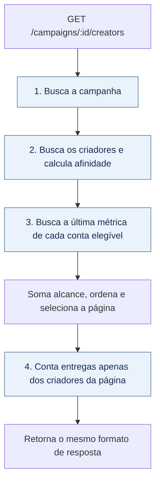

# Descoberta de criadores

[](https://github.com/leonardoperin14/conty-challenge-optimize/actions/workflows/ci.yml?query=branch%3Aperf%2Fcreator-discovery-iteration-2)

API que lista criadores compatíveis com uma campanha, ordenados por afinidade de nicho e alcance. A otimização reduz as consultas ao banco e preserva a resposta, os desempates e a paginação da implementação original.

**TypeScript · Node.js 22 · Hono · SQLite · Vitest**

A solução está na branch `perf/creator-discovery-iteration-2`, com o [PR #2 aberto no fork](https://github.com/leonardoperin14/conty-challenge-optimize/pull/2). O corpo do PR reúne o benchmark antes e depois, as validações e as decisões da implementação.

## Execução

Use Node.js 22. Os scripts de teste e benchmark usam sintaxe de ambiente de shells como Bash, disponível em Linux, macOS ou WSL.

```bash
npm ci
npm test
npm run typecheck
npm run bench
npm run dev
```

A API inicia em `http://127.0.0.1:3002`, com os dados do benchmark em SQLite na memória. `PORT` altera a porta.

```bash
curl 'http://127.0.0.1:3002/campaigns/cmp_01/creators?limit=20&offset=0'
```

A resposta contém `campaign_id`, `total` e `creators`. Cada criador tem `id`, `name`, `niche_score`, `latest_reach` e `deliveries_90d`. Campanha inexistente retorna `404`.

## O que foi otimizado

Antes, a listagem buscava contas, métricas e entregas individualmente para cada criador. Isso fazia o número de consultas crescer com o banco, o problema conhecido como N+1.

Agora, uma campanha existente usa **quatro consultas**, inclusive em páginas vazias. O total de chamadas ao banco permanece abaixo do orçamento de oito queries por página de 20, independentemente da quantidade de criadores. O volume de dados processados ainda cresce com o banco.



As consultas passam pelos wrappers `all` e `get` de [`src/db.ts`](src/db.ts), mantendo o contador de queries ativo. A terceira consulta usa uma subconsulta indexada por conta, dentro da mesma chamada SQL. Os índices cobrem contas por criador, métricas por conta/data/ID e entregas por criador/data.

## Regras preservadas

| Regra | Comportamento |
| --- | --- |
| Afinidade | `niche_score` conta pares de nichos iguais entre campanha e criador, incluindo repetições. Score zero fica de fora. |
| Alcance | Soma as views da última métrica de cada conta, preservando a ordem original de soma das contas. |
| Empate de métrica | Usa maior `captured_at`; no mesmo horário, maior `id`. |
| Ordenação | `niche_score` decrescente, `latest_reach` decrescente e `id` crescente. |
| Entregas | Conta `delivered_at` a partir do limite inclusivo de 90 dias antes de `2026-06-01T12:00:00.000Z`. |
| Paginação | `limit` padrão 20, máximo 50; `offset` padrão 0. Além do fim, retorna `creators: []` e preserva `total`. |
| Total | Quantidade de criadores compatíveis antes da paginação. |

A primeira página continua comparada com [`fixtures/page-1.json`](fixtures/page-1.json), preservado sem alterações. Os testes também comparam a versão otimizada com a implementação original em volumes maiores e casos de borda.

## Benchmark antes e depois

Medições registradas no [PR #2](https://github.com/leonardoperin14/conty-challenge-optimize/pull/2), em 10/10/2026: Windows x64, Node.js 22.23.3 e SQLite 3.51.3. O benchmark original usa **2.000 criadores, página de 20, uma chamada de aquecimento e cinco amostras**, com o seed fora da latência medida.

| Versão | Commit | Queries | p50 (ms) | p95 (ms) |
| --- | --- | ---: | ---: | ---: |
| Original | `b319e26` | 3.943 | 3.197,3 | 3.416,9 |
| Solução do PR #1 | `1a58fb2` | 4 | 34,9 | 41,2 |
| Solução do PR #2 | `be4b7c1` | 4 | 11,5 | 18,3 |

As duas soluções reduziram as queries de **3.943 para 4**. Nesta medição, o PR #2 teve p95 cerca de **55,6% menor que o PR #1** e **99,5% menor que o original**. O [PR #1](https://github.com/leonardoperin14/conty-challenge-optimize/pull/1) permanece disponível para comparação; a solução escolhida está no PR #2. Com cinco amostras, o p95 calculado pelo script é o maior tempo observado; esses valores não garantem a mesma latência em outros ambientes.

Para reproduzir, execute `npm ci` e `npm run bench` em cópias dos três commits, sequencialmente, no mesmo ambiente. O script [`scripts/bench.ts`](scripts/bench.ts) imprime `queries`, `p50_ms` e `p95_ms`.

Os números acima vêm do benchmark original. O script auxiliar `bench-iteration-2.ts` não foi usado nessas medições; sua comparação de abertura sem índices inclui criar e remover índices e não deve ser tratada como uma medição isolada de abertura.

## Entrega e validação

| Critério | Evidência |
| --- | --- |
| Correção em branch e PR no fork | [PR #2](https://github.com/leonardoperin14/conty-challenge-optimize/pull/2), aberto contra a `main` do próprio fork |
| Resposta igual ao fixture | Comparação com `fixtures/page-1.json` em [`test/discover.test.ts`](test/discover.test.ts) |
| Até oito queries por página de 20 | Testes de orçamento no seed e com 600 criadores; a solução faz quatro consultas |
| Equivalência em volumes maiores | [`test/equivalence-iteration-2.test.ts`](test/equivalence-iteration-2.test.ts) compara com a versão original, incluindo empates, alterações de dados e páginas além do fim |
| Acesso ao banco por `src/db.ts` | `listCreators` usa `all` e `get`, com a contagem de consultas preservada |
| Ganho medido | Queries e p95 antes e depois registrados no corpo do PR e na tabela acima |

A validação registrada no PR passou com **24 testes e typecheck**, além de revisão técnica com 14 comparações com a função oficial, em volumes de até 2.600 criadores. O [CI de push](https://github.com/leonardoperin14/conty-challenge-optimize/actions/runs/38084595916) e o [CI do PR](https://github.com/leonardoperin14/conty-challenge-optimize/actions/runs/38089157468) passaram para o commit `be4b7c1`.

O workflow executa `npm ci`, `npm test` e `npm run typecheck` em Ubuntu com Node.js 22. Nesta atualização do README, testes e benchmark não foram executados novamente; os resultados citados são os já registrados no PR.

## Limitações

A listagem ainda carrega criadores e ordena candidatos em memória, com custo de ordenação O(N log N). A quantidade de consultas é fixa, mas isso não torna o tempo de execução constante.

Os índices aumentam o armazenamento e o trabalho nas escritas. O benchmark mede a leitura da página; não mede capacidade de ingestão, concorrência ou comportamento sob carga de produção.

## Uso de IA e revisão

Usei o Codex para investigar o problema, implementar a otimização, criar testes adicionais e preparar a documentação. Uma segunda sessão fez a revisão técnica independente e executou as medições comparativas. Esta atualização do README também foi feita com esse apoio.

Minha participação foi definir o escopo e os checkpoints, acompanhar as evidências, pedir uma segunda abordagem e comparar os resultados antes de escolher a solução do PR #2. Não revisei cada linha do código nem executei os testes manualmente; a implementação, a revisão técnica e a execução das validações foram feitas com IA.
